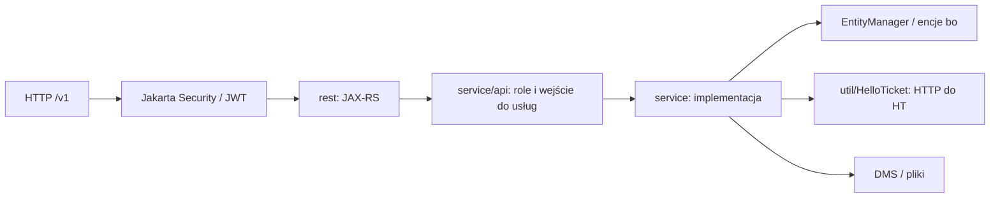

# Backend HP — dokumentacja techniczna

Stan źródeł: **31.10.2026**. Dokument opisuje lokalne repozytorium i sposób pracy nad kodem. Aktualne obrazy, konfigurację i stan bazy środowisk trzeba potwierdzać osobno.

## Dokumenty referencyjne

- [Endpointy JAX-RS](api-reference.md): jawne metody, ścieżki, typy odpowiedzi i parametry, z odnośnikami do implementacji.
- [Zależności Maven, klucze konfiguracji i SQL](configuration-reference.md): dane wyprowadzone z plików źródłowych, bez wartości dostępowych.
- [Praca lokalna i weryfikacja](development.md): wymagania, polecenia i granice dotychczasowych testów.

## Warstwy i przepływ żądania



[JaxRsActivator](../src/main/java/pl/hellopoland/rest/JaxRsActivator.java) ustala `/v1` i deklaruje role. Grupy zasobów to `rest/market`, `rest/helpdesk` oraz `rest/partner`. Publiczny prefiks reverse proxy może różnić się od kontekstu WAR-a `/hellopoland`.

`service/api` jest warstwą z adnotacjami uprawnień dla grup klientów. Nie wszystkie zasoby korzystają z identycznej drogi: np. [HelpdeskTechnicalRestService](../src/main/java/pl/hellopoland/rest/helpdesk/HelpdeskTechnicalRestService.java) ma własne `@RolesAllowed` i wywołuje serwis techniczny. Uprawnienia ustala się na całej ścieżce, nie z samego prefiksu URL.

`bo` zawiera encje; `rest/dto` zawiera wejścia/odpowiedzi specyficzne dla API. Wspólne obiekty `pl.hellopoland.dto` pochodzą z biblioteki `hp-dto`. Mapowanie modelu do odpowiedzi należy sprawdzać m.in. w `util/DtoMapper.java` oraz właściwym serwisie.

## Persistence i konfiguracja

[persistence.xml](../src/main/resources/META-INF/persistence.xml) wskazuje persistence unit `primary` i datasource `java:module/hellopolandDS`. [web.xml](../src/main/webapp/WEB-INF/web.xml) deklaruje datasource z parametrami filtrowanymi podczas budowania. Zmiana zewnętrznego `runtime.properties` nie zastępuje automatycznie każdego parametru datasource w wynikowym WAR-ze.

[POM](../pom.xml) czyta `maven.build.properties` i plik wybrany przez `local.maven.build.properties`. Profile `tst` i `prod` ustawiają pliki środowiskowe; TST jest domyślny. Filtrowane są zasoby, w tym deskryptory aplikacji.

[ServiceSuperclass](../src/main/java/pl/hellopoland/service/ServiceSuperclass.java) ładuje `runtime.properties` z classpath do właściwości JVM, następnie plik wskazany przez `-Dlocal.runtime.properties=...`. Jest to inicjalizacja klasy, a nie odczyt pliku przy każdym żądaniu. Zewnętrzne wartości nadpisują domyślne z zasobu.

Stan danych i migracje są odrębną częścią wdrożenia. Obecność skryptu SQL w Git nie jest historią wykonanych migracji. Wymaganą wersję schematu ustalamy z encji, skryptu zmiany i rzeczywistej bazy.

## Uwierzytelnienie i uprawnienia

- [JwtAuthenticationMechanism](../src/main/java/pl/hellopoland/security/JwtAuthenticationMechanism.java): obsługa HTTP, Bearer JWT oraz specjalnych ścieżek logowania/odświeżenia.
- [Authentication](../src/main/java/pl/hellopoland/security/Authentication.java): `IdentityStore`, sprawdzenie danych konta i credentials.
- [Authorization](../src/main/java/pl/hellopoland/security/Authorization.java): dostarczenie grup użytkownika.
- `@RolesAllowed` / `@PermitAll` w zasobach i usługach: decyzja o dostępie do operacji.

Klient nie powinien ustalać dostępu wyłącznie z widoczności elementów UI. Przykład żądania autoryzowanego wymaga tokenu dla właściwej grupy klientów; nie zapisujemy tokenów w dokumentacji.

## Integracje i granice transakcji

[HelloTicket](../src/main/java/pl/hellopoland/util/HelloTicket.java) realizuje wywołania HTTP. Operacja JPA w HP i operacja HTTP w HT nie tworzą automatycznie jednej transakcji rozproszonej. Przy błędzie między zapisami trzeba sprawdzić stan obu systemów przed ponowieniem.

DMS przechowuje pliki binarne; URL mediów i fizyczna ścieżka storage to różne elementy konfiguracji. W kontenerze potrzebne są właściwe montowania i prawa dostępu. Płatności i poczta wymagają własnej konfiguracji środowiskowej; działający `/ping` nie sprawdza ich kompletności.

## Artefakt, budowanie i kontrola

Źródłem wersji jest POM; kod jest kompilowany dla **Javy 21**, a Dockerfile wskazuje WildFly 34 z JDK 21. Bezpośrednie zależności i ich scope zestawiono w referencji.

Z katalogu `hp-client-backend`:

```sh
mvn -P tst test
mvn -P tst clean package
```

Wynik pakowania: `target/hellopoland.war`. Kompilacja wymaga dostępnej wersji `hellopoland-dto`; `mvn install` biblioteki lokalnie i publikacja dla CI to różne operacje.

Testy w `src/test` używają m.in. JUnit i atrap zależności. Testy jednostkowe nie potwierdzają działania interceptora EJB, rzeczywistych blokad PostgreSQL, migracji ani połączenia z HT. Takie przypadki wymagają osobnego testu na przygotowanym środowisku.

## Zmiana techniczna — miejsca kontroli

| Rodzaj zmiany | Co przejrzeć |
| --- | --- |
| Pole JSON | IRO/DTO, encja, mapper, walidacja, odbiorcy w panelach i WP |
| Endpoint | Adnotacje HTTP, role, service/API, format błędu, reverse proxy |
| Encja | Relacje JPA, schemat, migracja i zapytania zależne |
| Wywołanie HT | Przestrzenie ID, payload, błąd HTTP, częściowy zapis i ponowienie |
| Konfiguracja | Czy jest filtrowana w buildzie, czy ładowana w runtime; restart/rebuild |

W tej pracy nad dokumentacją nie zmieniano implementacji usług ani nie wykonywano buildów i wdrożeń.
